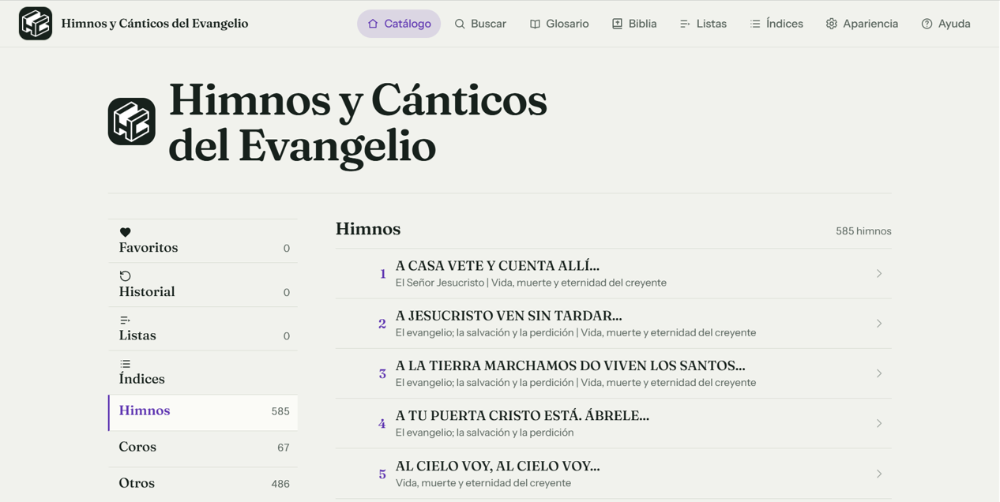
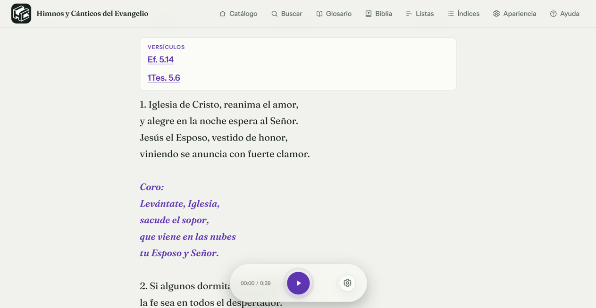

# 🎶 Himnos y Cánticos del Evangelio

> **Hay canciones que nos devuelven a un recuerdo, a una oración y a nuestra comunidad.**
> Un himnario renovado para encontrar esas canciones y llevarlas contigo.

🌐 **[Visita la página de presentación](https://andydev737.github.io/HC-Web/)**
📲 **[Abre Himnos y Cánticos del Evangelio](https://himnos-y-canticos-del-evangelio.pages.dev/)**

La app pone una amplia colección de himnos al alcance de tu mano: búscalos por
número o por una frase que recuerdes, vuelve a leer sus letras, escucha sus
melodías y consulta sus partituras. También integra la Biblia RVR1960 y puede
instalarse como aplicación web para acompañarte incluso cuando no tengas
conexión.

**Sin crear una cuenta. Sin anuncios. Tus himnos, contigo.** 🙌

---

## ✨ Un himnario, muchas maneras de volver a cantar

La aplicación reúne:

- **Más de 1.500 himnos y cánticos**, organizados en cuatro secciones: Himnos, Coros,
  Otros e Inglés.
- **Más de 1.600 melodías** para escuchar.
- **Una colección de partituras en PDF vectorial de 793 páginas.**
- **La Biblia Reina-Valera 1960 completa:** 66 libros, 1.189 capítulos y
  31.104 versículos.

### 🔎 Encuentra ese himno que tienes en mente

Busca por número o escribe una palabra, una frase o un fragmento de la letra.
Explora el catálogo por sección y consulta índices y resultados relacionados.
Una vista previa te permite reconocer el himno antes de abrirlo.

### 🎼 Lee, escucha y sigue la partitura

- Consulta la letra y sus referencias bíblicas.
- Escucha las melodías con sonido de piano.
- Ajusta el tono, el tempo y el volumen según lo necesites.
- Abre la partitura correspondiente y amplíala para verla con claridad.

### 📖 Estudia la Biblia en el mismo lugar

Recorre los libros y capítulos de la **RVR1960**, sigue referencias cruzadas y
encuentra himnos que citan el capítulo que estás leyendo. Guarda notas privadas
y versículos favoritos con colores personalizados.

### 💜 Haz tuyo el himnario

Guarda tus himnos favoritos, vuelve a los consultados recientemente y crea
listas personalizadas para reuniones, momentos de reflexión o para compartir
con tu congregación.

### 📡 Llévalo contigo, incluso sin señal

La app es una **PWA instalable**: puedes añadirla a la pantalla de inicio desde
un navegador compatible y preparar el contenido para usarlo sin conexión. No
necesitas descargarla desde una tienda ni crear una cuenta. La experiencia está
diseñada para teléfonos, tabletas y computadoras.

> La disponibilidad de instalación y algunas funciones puede variar según el
> navegador y el dispositivo. La compatibilidad en un dispositivo concreto debe
> comprobarse en ese dispositivo.

---

## 🆕 ¿Qué presenta esta nueva etapa?

La página cuenta la evolución del proyecto: de una aplicación Android pesada a
una experiencia web más ligera, adaptable y accesible desde distintos
dispositivos. En la landing, el cambio se presenta como pasar de una descarga de
más de 300 MB a una experiencia de menos de 50 MB.

También encontrarás:

- Una **búsqueda interactiva de demostración** para probar algunos himnos.
- Capturas de la portada y de la lectura de un himno.
- Una presentación de la Biblia, la música, las partituras y el uso offline.
- Una cronología con la historia del proyecto.
- El logo animado, con una alternativa estática para quienes prefieren reducir
  el movimiento.

> **Nota:** la búsqueda de la landing es solo una muestra y contiene cinco
> himnos de ejemplo. Para explorar el catálogo completo, abrir enlaces, escuchar
> melodías y utilizar las demás funciones, entra en la app.

---

## 🖼️ Un vistazo a la aplicación

**Portada**

**Lectura de un himno**

---

## 🏷️ Versión

**Versión web: `3.1.0`**

## Historial de versiones

Resumen de las novedades publicadas en la aplicación:

- **3.1.0** — La instalación inicial es más rápida; ahora puedes descargar todos los recursos offline o guardarlos a medida que los usas.
- **3.0.6** — Se añadió la búsqueda de texto en toda la Biblia y el acceso a himnos relacionados por capítulo.
- **3.0.5** — Se añadió el himno Otros 487 y su pista MIDI.
- **3.0.4** — Se renovó la presentación de la landing, con logo animado y una muestra interactiva del detalle de un himno.
- **3.0.3** — La Biblia incorporó notas privadas, favoritos de versículos con color y una lista de estudio; se ampliaron la navegación por índices y los enlaces entre citas bíblicas e himnos.
- **3.0.2** — Mejoras en la preparación offline de la PWA y en la finalización y el bucle del reproductor MIDI.
- **3.0.1** — Corrección de la disponibilidad offline de las partituras PDF y ajustes del precache.
- **3.0.0** — Primera versión web 3.x, con catálogo, búsqueda, lectura de himnos, reproducción MIDI, partituras y navegación renovada.

La sección **Ayuda → Novedades por versión** contiene el mismo resumen dentro de la app.

La versión corresponde a la declarada por la aplicación web en su proyecto y
en su sección «Acerca de». La landing es un sitio estático independiente y no
tiene un número de versión propio.

---

## 🔗 Enlaces

| Recurso | Enlace |
| --- | --- |
| Aplicación web | [himnos-y-canticos-del-evangelio.pages.dev](https://himnos-y-canticos-del-evangelio.pages.dev/) |
| Página de presentación y desarrollo | [andydev737.github.io/HC-Web](https://andydev737.github.io/HC-Web/) |
| Repositorio de esta landing | [github.com/AndyDev737/HC-Web](https://github.com/AndyDev737/HC-Web) |

---

## 💌 Créditos

Hecho con gratitud para quienes aman estos himnos.

Logo: **Natanael Jiménez** · [Instagram](https://www.instagram.com/nata_neudesign/)

Desarrollo: [andydev737@gmail.com](mailto:andydev737@gmail.com)

**Que cada himno encuentre su camino de vuelta.** 🎵
